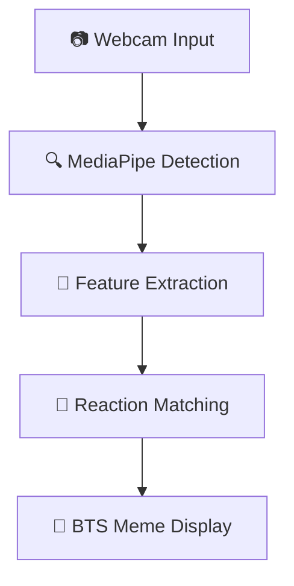

<div align="center">

# 💜 BTS Reaction Cam

### Your Expressions. Your Reactions. Your BTS Memes.

**An interactive computer vision application that matches your facial expressions, hand gestures, and body poses with BTS reaction memes in real time.**

<br>


<br>


---

**[Overview](#-overview) • [Features](#-features) • [How It Works](#-how-it-works) • [Installation](#-installation) • [Usage](#-usage) • [Tech Stack](#-tech-stack)**

</div>

<br>

## ✨ Overview

**BTS Reaction Cam** is an interactive Python application that transforms facial expressions and body movements into personalized BTS meme reactions.

Using real-time computer vision, the application analyzes the user's facial movements, hand gestures, and body poses through a webcam.

Each reaction is matched with a specific BTS meme from a personalized collection.

Unlike traditional random meme generators, BTS Reaction Cam allows users to train individual reactions, creating a unique and interactive experience.

### The Concept

> Make a face. Strike a pose. Get a BTS reaction. 💜

The application combines computer vision, facial landmark detection, and personalized gesture recognition to create a fun, interactive experience.

<br>

## 🎬 Demo

The application displays two panels side by side:

| Live Camera | BTS Reaction |
|:---:|:---:|
| Real-time webcam feed | Matched BTS meme |
| Facial expression tracking | Personalized reaction |
| Hand and pose recognition | Automatic meme selection |

**Demo preview:** Coming soon.

*A demonstration GIF or screenshot will be added in a future update.*

<br>

## 🚀 Features

### 🎭 Facial Expression Recognition

Detects facial movements using MediaPipe Face Landmarker.

- Smiling
- Surprised expressions
- Raised eyebrows
- Eye movements
- Mouth movements
- Other personalized facial expressions

### ✋ Hand Gesture Detection

Recognizes hand landmarks and gestures.

- Peace signs
- Thumbs up
- Open palms
- Hand movements
- Custom gestures

### 🧍 Body Pose Tracking

Analyzes body landmarks to recognize movements and poses.

- Arm positions
- Upper-body movements
- Shoulder positions
- Personalized poses

### 💜 Personalized BTS Meme Matching

Each meme can have its own trained reaction.

The application compares live webcam features with previously recorded samples to identify the closest match.

### 🔄 Custom Reaction Training

Users can:

- Record their own expressions and poses.
- Assign a unique reaction to each meme.
- Retrain individual reactions.
- Save calibration data locally.
- Continue training in future sessions.

### ⚡ Real-Time Processing

The application processes webcam frames continuously and uses temporal stabilization to reduce accidental reaction switching.

<br>

## 🧠 How It Works

The application follows a five-stage computer vision pipeline.



### 1. Webcam Capture

OpenCV captures real-time frames from the user's webcam.

### 2. Landmark Detection

MediaPipe extracts:

- Facial blendshape scores
- Hand landmarks
- Body pose landmarks

### 3. Feature Extraction

Detected landmarks are converted into numerical feature vectors.

### 4. Similarity Matching

The application compares the current feature vector with stored user-trained samples.

A similarity threshold helps reject uncertain matches.

### 5. Reaction Display

When a sufficiently confident reaction is detected, the corresponding BTS meme appears on screen.

**Note:** The system recognizes visual patterns rather than determining a person's actual emotional state.

<br>

## 🛠️ Tech Stack

| Technology | Purpose |
|:---|:---|
| **Python 3.11** | Core application logic |
| **OpenCV** | Webcam capture and image processing |
| **MediaPipe Face Landmarker** | Facial expression features |
| **MediaPipe Gesture Recognizer** | Hand gesture detection |
| **MediaPipe Pose Landmarker** | Body pose tracking |
| **NumPy** | Numerical feature processing |
| **Pillow** | Image utilities |
| **JSON** | Reaction configuration and calibration storage |

The main personalized matching system uses MediaPipe rather than YOLO because it relies primarily on facial, hand, and body landmarks.

<br>

## 📦 Installation

### Prerequisites

- Python 3.11
- macOS
- Webcam
- pip
- Internet connection for the initial model download

The project was developed for an Intel-based MacBook Air.

### 1. Clone the Repository

```bash
git clone https://github.com/darinabd/bts-reaction-cam.git
cd bts-reaction-cam
```

### 2. Create a Virtual Environment

```bash
python3.11 -m venv .venv
```

Activate it:

```bash
source .venv/bin/activate
```

### 3. Install Dependencies

```bash
python -m pip install --upgrade pip
python -m pip install -r requirements.txt
```

### 4. Download MediaPipe Models

```bash
python setup_models.py
```

The application requires three MediaPipe models:

- Face Landmarker
- Gesture Recognizer
- Pose Landmarker

**macOS SSL troubleshooting**

If Python reports a certificate verification error:

```bash
python -m pip install certifi
```

Then run:

```bash
SSL_CERT_FILE="$(python -m certifi)" python setup_models.py
```

This uses a trusted certificate bundle without disabling SSL verification.

<br>

## 🎮 Usage

### Training Mode

Start the training interface:

```bash
python app.py --train
```

The first training step records a neutral facial expression.

Afterward, the application displays each meme and allows the user to record a corresponding expression or pose.

| Key | Action |
|:---:|:---|
| `SPACE` | Record expression or pose |
| `N` | Next meme |
| `B` | Previous meme |
| `Q` | Finish training |
| `ESC` | Exit |

Training samples are saved automatically.

To replace an existing reaction, navigate to the corresponding meme and record a new sample.

### Reaction Mode

Start the main application:

```bash
python app.py
```

The webcam begins analyzing expressions and gestures in real time.

When a trained reaction is recognized, its corresponding meme is displayed.

### Alternative Camera

To select a different webcam:

```bash
python app.py --camera 1
```

### Demo Mode

A legacy demonstration mode is also available:

```bash
python app.py --demo
```

This mode provides keyboard-controlled reaction previews and does not use the personalized 29-meme matching system.

<br>

## 📂 Project Structure

```text
bts-reaction-cam/
│
├── app.py
├── personal_cam.py
├── pose_matcher.py
├── recognition.py
├── catalog.py
├── media.py
│
├── setup_models.py
├── requirements.txt
├── README.md
├── .gitignore
│
├── pose_guides.json
├── reactions.json
│
├── assets/
│   └── collection/
│
├── models/
│
└── tests/
    ├── test_catalog.py
    ├── test_pose_guides.py
    ├── test_pose_matcher.py
    └── test_recognition.py
```

<br>

## 🧪 Testing

Run the automated unit tests:

```bash
python -m unittest discover -s tests -v
```

The test suite covers:

- Reaction classification
- Gesture priority
- Pose feature extraction
- Personalized reaction matching
- Reaction stabilization
- Meme catalog behavior

**Important:** The original tests expect the personal meme collection to be available. Tests involving those assets may fail in a clean public clone until asset-independent test fixtures are added.

Webcam and graphical interface functionality should also be tested manually on a compatible Mac.

<br>

## 🔐 Privacy

BTS Reaction Cam is designed to process webcam input locally.

- No account is required.
- Webcam footage is not uploaded.
- Training data remains on the user's computer.
- Personal calibration files are excluded from Git.
- MediaPipe model binaries are downloaded separately.

The generated `calibration.json` contains numerical features derived from facial expressions and poses.

**Do not upload personal calibration files to public repositories.**

<br>

## 📸 Media & Copyright

The original project uses a personal collection of 29 BTS reaction images.

These images are intentionally excluded from the public GitHub repository.

Users must provide their own legally usable images in:

```text
assets/collection/
```

The configuration files reference the filenames used in the original collection. Users may adjust these mappings to work with their own images.

BTS imagery and other third-party content belong to their respective rights holders.

<br>

## 🔮 Future Improvements

- [ ] Improved recognition accuracy
- [ ] Multiple training samples per reaction
- [ ] Interactive reaction library
- [ ] Video memes with synchronized audio
- [ ] Improved graphical interface
- [ ] Reaction recording
- [ ] Additional customization options
- [ ] Cross-platform support

<br>

## 👩🏻‍💻 Developer

**Darina Burnasheva**


**GitHub:** [@darinabd](https://github.com/darinabd)

<br>

---

<div align="center">

### 💜 Made with Python, Computer Vision & a little BTS chaos.

*An experimental project combining technology, creativity, and fandom.*

**If you enjoyed this project, consider giving it a ⭐!**

</div>
